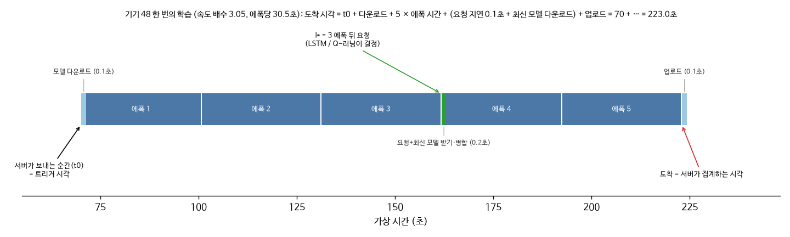
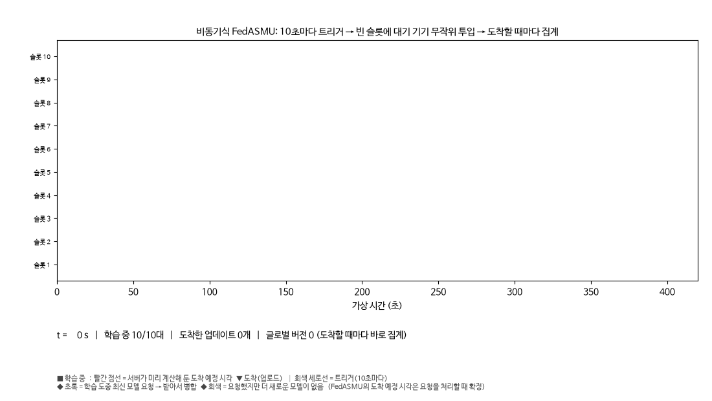
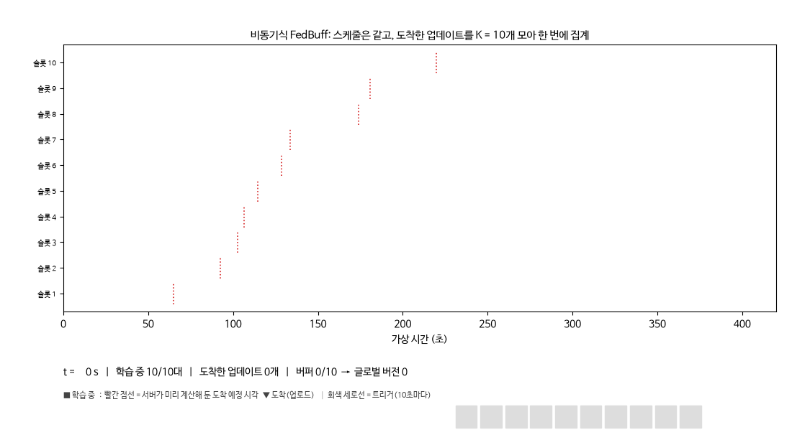
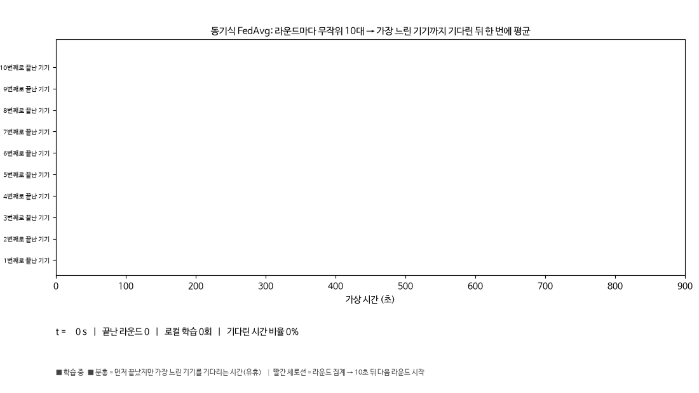
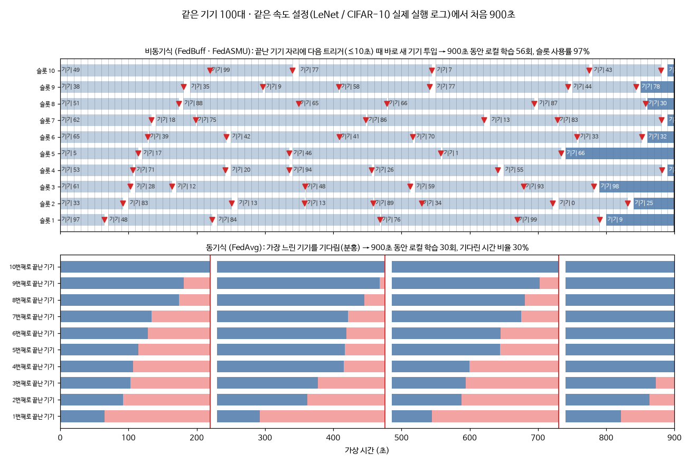
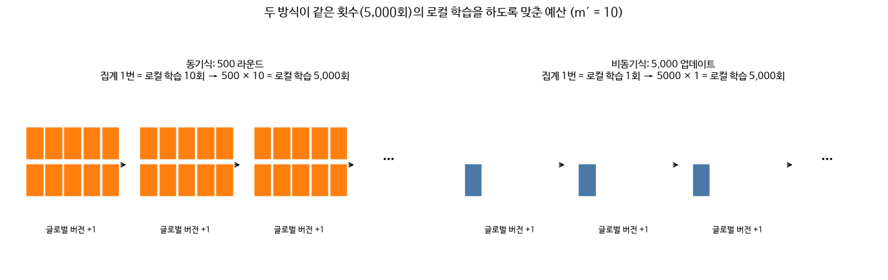

# 기기 선정과 스케줄링, 그리고 "바닐라" 학습 방식

## 읽기 전에

- 그림과 애니메이션은 `scripts/scheduling_figures.py`로 만들었습니다. 모두 실제 실행 로그(LeNet / CIFAR-10, seed 0)에서 그린 것이며, 결과물은 `results/figures/scheduling/`에 있습니다.
- 각 학습을 언제 보냈는지(시작 시각)는 로그에 따로 없어서, 도착 시각과 기기 속도 정보로 역산했습니다. 다음 두 가지로 역산이 정확한지 확인했습니다.
  - 비동기: 역산한 시작 시각이 모두 트리거 시각(10초의 배수)에 정확히 떨어집니다(100 %).
  - 동기: 각 라운드에서 가장 느린 기기의 종료 시각이 로그의 라운드 시각과 0.001초 이내로 같습니다.

## 1. 기기 한 대가 한 번 학습하는 과정과 도착 시각 계산

**서버가 기기에 작업을 보내는 순간(t₀) 도착 시각을 미리 계산합니다.**
- 도착 시각 = t₀ + 모델 다운로드 + L × (그 기기의 에폭 시간) + 업로드
- FedASMU는 여기에 학습 도중 요청하는 시간이 더해집니다: 요청 지연 0.1초 + (서버가 더 새 모델을 보낸 경우) 다운로드 시간
- 이 시각에 도착 이벤트가 이벤트 큐에 들어가고, 서버는 가상 시간 순서대로 이벤트를 처리합니다.
- 실제 학습은 GPU에서 하고, 시간 축은 기기 속도 설정대로 계산합니다.
- 코드: `src/nvflare_integration/controller.py` `_dispatch`(284–312행), `_process_request`(391–412행)

**도착 예정 시각이 확정되는 시점은 알고리즘마다 다릅니다.**
- FedBuff와 FedAvg는 보내는 순간 확정됩니다.
- FedASMU는 학습 도중 요청을 서버가 처리하는 순간 확정됩니다. 그때 새 모델을 보낼지가 정해지기 때문입니다.

## 2. 비동기 기기 선정 (FedASMU, FedBuff)

**선정 규칙**
1. 서버는 T = 10초마다 트리거를 겁니다.
2. 학습 중이 아닌 기기 가운데서 무작위로 골라, 동시에 학습하는 기기가 최대 m′ = 10대(전체의 10 %)가 될 때까지 빈자리를 채웁니다.
3. 학습 결과가 도착하면 바로 집계합니다(FedASMU Eq. 1).
4. 그 기기 자리는 다음 트리거 때 다른 대기 기기로 채워집니다.

코드: `controller.py` `_async_loop`(377–385행), 기기 속도 설정은 `src/scheduling/device_profiles.py` `make_profiles`

**FedASMU의 추가 동작**
- 학습 중 l* 에폭 뒤에 최신 모델을 요청합니다(◆).
- 서버에 더 새 모델이 있으면 받아서 병합합니다(초록). 없으면 그대로 계속 학습합니다(회색).

**FedBuff**

- 기기 선정 방식은 FedASMU와 같습니다.
- 차이는 집계뿐입니다. 도착한 업데이트를 버퍼에 K = 10개 모은 뒤 한 번에 집계합니다(NVFLARE `BuffModelManager`).

## 3. 동기 기기 선정 (FedAvg)

1. 라운드마다 전체 100대 중 무작위로 10대를 고릅니다.
2. 10대가 같은 글로벌 모델로 동시에 학습을 시작합니다.
3. 가장 느린 기기가 끝날 때까지 기다린 뒤, 데이터 크기로 가중 평균합니다.
4. T = 10초 뒤 다음 라운드를 시작합니다.

먼저 끝난 기기는 다음 라운드까지 쉽니다(분홍 막대). 코드: `controller.py` `_fedavg_loop`(526–577행)

## 4. 같은 900초 동안 비교

| 방식 | 900초 동안 로컬 학습 횟수 | 자원 사용 |
|---|---|---|
| 비동기 | 56회 | 슬롯 사용률 97 % |
| 동기 | 30회 | 기다리는 시간 30 % |

- 이 실험의 기기 속도 차이는 5배이고 속도는 균등 분포로 뽑았습니다.
- 이 조건에서 동기식은 같은 횟수의 로컬 학습을 하는 데 비동기식보다 약 1.55배 오래 걸립니다(이론값과 로그 일치).

## 5. 예산: 동기 500 라운드 = 비동기 5,000 업데이트

| 방식 | 집계 1번당 로컬 학습 | 예산 | 로컬 학습 총횟수 |
|---|---|---|---|
| 동기식 | 10회 | 500 라운드 | 5,000회 |
| 비동기식 | 1회 | 5,000 업데이트 | 5,000회 |

두 방식의 로컬 학습 총횟수가 같아지도록 맞춘 예산입니다(m′ = 10).

## 6. 우리 학습 방식을 "바닐라(기본)"라고 부를 수 있는 이유: SASAFL과 비교

### 비교 표

출처:
- **FedAvg 원논문**: McMahan et al., AISTATS 2017
- **SASAFL**: Yu, Choi, Lee, Oh, *Staleness aware semi-asynchronous federated learning*, JPDC 193 (2024) 104950, 5.1절 Experiment setup
- **FedASMU**: arXiv 2312.05770 부록

| 항목 | FedAvg 원논문 | SASAFL 실험 | FedASMU 논문 | 우리 |
|---|---|---|---|---|
| 전체 클라이언트 K | 100 | 30, 100 | 100 | 100 |
| 라운드당 참여 비율 | C = 0.1 (기준값) | 최소 참여 비율 C = 0.1 ([2] = FedAvg 인용), 0.3, 0.5 | m′ = 10 (10 %) | 10대 (10 %) |
| 로컬 epoch | E = 5 (1, 5, 20도 실험) | E = 5 (받은 모델에 따라 최소 E/2까지 줄임) | 미공개 | 5 |
| 배치 | B = 10, 50 등 (CIFAR는 50) | 32 | 미공개 | 50 |
| 로컬 최적화 | SGD | 옵티마이저 명시 없음, 학습률 0.01 (MNIST) / 0.001 (FMNIST, CIFAR-10) | SGD (Formula 4) | SGD (모멘텀 · weight decay 없음) |
| 집계 | 데이터 크기 가중 평균 | [2]와 같은 가중 평균 + staleness 감쇠(ζ = 0.9) | Eq. 1 (동적 α) | FedAvg: 가중 평균 / FedBuff: NVFLARE 공식 / FedASMU: Eq. 1 |
| 클라이언트 선정 | 매 라운드 무작위 | 반동기: 버퍼에 P_r개가 모이면 집계, P_r을 손실에 따라 조정, 클라이언트별 모델 수신 정책 | 비동기: 대기 기기를 주기적으로 무작위 트리거 | 동기: 무작위 10대 / 비동기: 대기 기기 무작위 트리거 |
| 비IID | 클라이언트당 2개 shard(2개 레이블) | 클라이언트당 1–2개 레이블, 데이터 양은 가우시안 | Dirichlet (Li et al. 2021) | Dirichlet α = 0.5 |
| 시스템 이질성 | 없음 | 실제 CPU 코어 수(1, 2, 3, 4 또는 5, 8코어 5그룹) | 학습 시간 5배 범위 무작위 | 가상 시간 1–5배 무작위 |
| 시간 측정 | 라운드 수 | 실제 wall-clock (KISTI 누리온 KNL 클러스터, PyTorch gloo) | 시뮬레이션 시간 | 가상 시간 (이벤트 시뮬레이션) |
| 모델 | CNN(2 conv), 2NN | [2]와 같은 CNN | 6종 | 6종 (CNN은 FedASMU 표 3) |
| 반복 | — | 설정당 10회 평균 | 미공개 | seed 1개 |

### 왜 "바닐라"인가

**1. 학습 과정 자체를 바꾸지 않았습니다.**
- 클라이언트는 받은 모델로 정해진 epoch 수(5)만큼 일반 SGD를 합니다.
- 모멘텀, 서버 옵티마이저, 데이터 증강, 근접항(FedProx), 대조 손실(MOON)이 없습니다.
- 속도를 보고 고르는 선정, 마감 시간(deadline), 부분 학습, epoch 줄이기도 없습니다.

**2. 선정과 집계가 각 기법의 원래 정의 그대로입니다.**
- **FedAvg**: 무작위 C = 0.1과 데이터 크기 가중 평균. McMahan의 CIFAR 설정(K = 100, C = 0.1, E = 5, B = 50)과 같습니다.
- **FedBuff**: NVFLARE 공식 구현을 수정 없이 썼습니다.
- **FedASMU**: 논문 Eq. 1–9만 더했습니다.
- 따라서 결과 차이는 각 기법의 알고리즘에서 나온 것으로 볼 수 있습니다.

**3. SASAFL과의 관계**
- SASAFL도 FedAvg를 출발점으로 삼습니다. C = 0.1, E = 5, 집계식, CNN을 모두 [2](FedAvg)에서 가져왔습니다.
- SASAFL의 기여는 이 위에 프로토콜 변경을 더한 것입니다: 반동기 버퍼, 참여 수 조정, 모델 수신 정책, epoch 줄이기, staleness 감쇠.
- 우리 설정은 이런 프로토콜 변경이 없는 기준선(FedAvg / 비동기 FedAsync 계열 / FedBuff) 쪽에 해당합니다.

**4. SASAFL과 다른 점: 측정 환경**

| 항목 | SASAFL | 우리 |
|---|---|---|
| 시간 | 실제 CPU 클러스터의 wall-clock | 가상 시간 |
| 이질성 | 코어 수로 만듦 | 시간 배수로 만듦 |
| 비IID | 1–2개 레이블 | Dirichlet |
| 반복 | 10회 평균 | seed 1개 |

우리 쪽 설정은 재현 대상인 FedASMU 논문이 쓴 방식(시뮬레이션 시간, Dirichlet)을 따른 것입니다.
